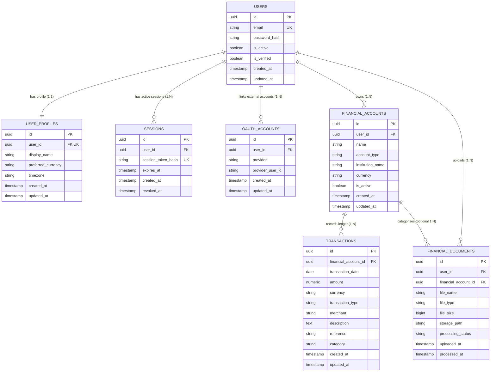

# Database Architecture & Design (Phase 2)

AI-Powered Personal Financial Decision Support System  
PostgreSQL 16 · SQLAlchemy 2.0 · Alembic

---

## 1. Overview & Architectural Principles

The database architecture is designed to support a deterministic personal finance decision support system. PostgreSQL serves as the single source of truth for user identities, authentication sessions, third-party OAuth links, multi-currency financial accounts, ledger transactions, and document ingestion metadata.

### Architectural Tiers

```
   ┌──────────────────────────────────────────────┐
   │             FastAPI Application              │
   └──────────────────────┬───────────────────────┘
                          │
                          ▼
   ┌──────────────────────────────────────────────┐
   │        SQLAlchemy 2.0 ORM & Core             │
   │  (DeclarativeBase, Mapped types, Session)    │
   └──────────────────────┬───────────────────────┘
                          │
                          ▼
   ┌──────────────────────────────────────────────┐
   │             PostgreSQL 16 Engine             │
   │  (UUID PKs, NUMERIC(18,4), Strict FK & Idx)  │
   └──────────────────────────────────────────────┘
```

### Why PostgreSQL?
- **Transactional Integrity (ACID)**: Absolute consistency is required for financial balances and transaction ledgers.
- **Rich Data Types**: Native support for `UUID`, high-precision `NUMERIC`, timezone-aware `TIMESTAMPTZ`, and indexed structured metadata.
- **Robust Constraint Enforcement**: Enforces referential integrity, compound unique constraints, and foreign key cascades at the database engine level.

### Why SQLAlchemy 2.0?
- **Type-Safe Declarative Mapping**: Modern SQLAlchemy 2.0 `Mapped` and `mapped_column` type annotations integrate cleanly with Python type checkers and IDEs.
- **Separation of Concerns**: Modular models mapped across dedicated files (`user.py`, `profile.py`, `session.py`, `financial_account.py`, `transaction.py`, etc.).
- **Query Precision & Security**: Parameterised queries by default protect against SQL injection vulnerabilities.

### Why Alembic?
- **Auditable Version Control**: Every change to database structure is tracked as a version-controlled migration script in `backend/migrations/versions/`.
- **Reproducible Environments**: Production, staging, and local development environments share an identical schema through `alembic upgrade head`.

---

## 2. Entity-Relationship Diagram



---

## 3. Table Specifications & Schema Details

### 1. `users`
- **Purpose**: Core application identity entity.
- **Columns**:
  - `id` (`UUID`, PK): Random UUID v4 identifier.
  - `email` (`VARCHAR(255)`, NOT NULL, UNIQUE, INDEX): Normalized user email address.
  - `password_hash` (`VARCHAR(255)`, NULLABLE): Nullable to support OAuth-only accounts that authenticate without local passwords.
  - `is_active` (`BOOLEAN`, NOT NULL, default `true`): Account state switch.
  - `is_verified` (`BOOLEAN`, NOT NULL, default `false`): Verification state (email verification).
  - `created_at` (`TIMESTAMPTZ`, NOT NULL, default `now()`): Creation audit timestamp.
  - `updated_at` (`TIMESTAMPTZ`, NOT NULL, default `now()`): Modification audit timestamp.

### 2. `user_profiles`
- **Purpose**: Stores profile preferences separately from credentials and authentication identities.
- **Columns**:
  - `id` (`UUID`, PK): Random UUID v4 identifier.
  - `user_id` (`UUID`, NOT NULL, UNIQUE, INDEX, FK → `users.id` `ON DELETE CASCADE`): Enforces a strict 1:1 relationship with the user identity.
  - `display_name` (`VARCHAR(100)`, NULLABLE): User's selected display name.
  - `preferred_currency` (`VARCHAR(3)`, NOT NULL, default `'USD'`): ISO 4217 currency code for dashboard aggregation.
  - `timezone` (`VARCHAR(50)`, NOT NULL, default `'UTC'`): IANA timezone identifier for presentation.
  - `created_at` / `updated_at` (`TIMESTAMPTZ`, NOT NULL, default `now()`).

### 3. `sessions`
- **Purpose**: Server-side authentication session management for secure revocation and activity tracking.
- **Columns**:
  - `id` (`UUID`, PK): Session record ID.
  - `user_id` (`UUID`, NOT NULL, INDEX, FK → `users.id` `ON DELETE CASCADE`): Owning user.
  - `session_token_hash` (`VARCHAR(255)`, NOT NULL, UNIQUE, INDEX): Cryptographic hash (e.g. SHA-256) of the bearer token. Raw tokens are never stored.
  - `expires_at` (`TIMESTAMPTZ`, NOT NULL, INDEX): Session expiration boundary for fast cleanup queries.
  - `created_at` (`TIMESTAMPTZ`, NOT NULL, default `now()`).
  - `revoked_at` (`TIMESTAMPTZ`, NULLABLE): Timestamp of explicit logout or revocation (`NULL` while active).

### 4. `oauth_accounts`
- **Purpose**: Connects third-party identity providers (Google, Facebook, GitHub, etc.) to internal user identities.
- **Columns**:
  - `id` (`UUID`, PK): Record identifier.
  - `user_id` (`UUID`, NOT NULL, INDEX, FK → `users.id` `ON DELETE CASCADE`).
  - `provider` (`VARCHAR(50)`, NOT NULL): Provider name (`google`, `facebook`, etc.).
  - `provider_user_id` (`VARCHAR(255)`, NOT NULL): Provider's persistent unique user identifier.
  - `created_at` / `updated_at` (`TIMESTAMPTZ`, NOT NULL, default `now()`).
  - **Constraint**: `uq_oauth_provider_user_id` on `(provider, provider_user_id)`.

### 5. `financial_accounts`
- **Purpose**: Represents financial accounts owned by users (checking, savings, credit cards, loans, cash, investment portfolios).
- **Columns**:
  - `id` (`UUID`, PK): Account ID.
  - `user_id` (`UUID`, NOT NULL, INDEX, FK → `users.id` `ON DELETE CASCADE`): Account owner.
  - `name` (`VARCHAR(100)`, NOT NULL): Friendly account label (e.g. "Chase Freedom Flex").
  - `account_type` (`VARCHAR(50)`, NOT NULL): Extensible type (`bank`, `savings`, `credit_card`, `cash`, `loan`, `investment`, `other`).
  - `institution_name` (`VARCHAR(100)`, NULLABLE): Financial institution (e.g. "Vanguard", "Barclays").
  - `currency` (`VARCHAR(3)`, NOT NULL, default `'USD'`): Native currency for the account.
  - `is_active` (`BOOLEAN`, NOT NULL, default `true`).
  - `created_at` / `updated_at` (`TIMESTAMPTZ`, NOT NULL, default `now()`).

### 6. `transactions`
- **Purpose**: Normalized financial ledger records.
- **Columns**:
  - `id` (`UUID`, PK): Transaction ID.
  - `financial_account_id` (`UUID`, NOT NULL, INDEX, FK → `financial_accounts.id` `ON DELETE CASCADE`): Associated account.
  - `transaction_date` (`DATE`, NOT NULL, INDEX): Value or posting date.
  - `amount` (`NUMERIC(18, 4)`, NOT NULL): Exact financial decimal value.
  - `currency` (`VARCHAR(3)`, NOT NULL): Original transaction currency.
  - `transaction_type` (`VARCHAR(20)`, NOT NULL): Type classification (`debit`, `credit`, `transfer`).
  - `merchant` (`VARCHAR(255)`, NULLABLE): Counterparty name.
  - `description` (`TEXT`, NULLABLE): Full statement description or memo.
  - `reference` (`VARCHAR(100)`, NULLABLE): Statement reference or check number.
  - `category` (`VARCHAR(100)`, NULLABLE): Categorization tag (initially nullable).
  - `created_at` / `updated_at` (`TIMESTAMPTZ`, NOT NULL, default `now()`).
  - **Composite Index**: `ix_transactions_account_date` on `(financial_account_id, transaction_date)`.

### 7. `financial_documents`
- **Purpose**: Metadata and state tracking for user-uploaded statements and financial receipts (PDF, CSV, OFX).
- **Columns**:
  - `id` (`UUID`, PK): Document ID.
  - `user_id` (`UUID`, NOT NULL, INDEX, FK → `users.id` `ON DELETE CASCADE`): Uploader.
  - `financial_account_id` (`UUID`, NULLABLE, INDEX, FK → `financial_accounts.id` `ON DELETE SET NULL`): Optional target account.
  - `file_name` (`VARCHAR(255)`, NOT NULL): Original filename.
  - `file_type` (`VARCHAR(50)`, NOT NULL): MIME type or extension.
  - `file_size` (`BIGINT`, NOT NULL): Size in bytes.
  - `storage_path` (`VARCHAR(500)`, NOT NULL): Storage reference / filesystem path.
  - `processing_status` (`VARCHAR(50)`, NOT NULL, default `'uploaded'`, INDEX): Ingestion pipeline state (`uploaded`, `processing`, `processed`, `failed`).
  - `uploaded_at` (`TIMESTAMPTZ`, NOT NULL, default `now()`).
  - `processed_at` (`TIMESTAMPTZ`, NULLABLE): Completion timestamp.

---

## 4. Key Design Decisions

### Monetary Precision
- **Never use floating-point types (`FLOAT`, `REAL`, `DOUBLE PRECISION`) for money**: Floating-point representations introduce binary rounding inaccuracies (e.g. `100.10` becomes `100.09999999999999`).
- **PostgreSQL `NUMERIC(18, 4)` mapped to Python `decimal.Decimal`**: Preserves up to 14 integer digits and 4 fractional decimal places (supporting fractional cents and cryptocurrency precision where relevant).

### Primary Keys & UUIDs
- UUID v4 (`sa.Uuid(as_uuid=True)`) prevents sequential enumeration attacks, enables distributed or client-side ID generation, and obscures internal business volume from external observers.

### Timestamps & Timezones
- All stored timestamps use `TIMESTAMP WITH TIME ZONE` (`TIMESTAMPTZ` / `DateTime(timezone=True)`) in UTC.
- Display conversion to the user's local timezone is handled at the presentation layer using the `user_profiles.timezone` setting.

### Referential Integrity & `ON DELETE` Behaviors
- **`ON DELETE CASCADE`**:
  - `users` → `user_profiles`, `sessions`, `oauth_accounts`, `financial_accounts`, `financial_documents`.
  - `financial_accounts` → `transactions`: Deleting an account removes its ledger entries cleanly, ensuring no orphaned transactions exist.
- **`ON DELETE SET NULL`**:
  - `financial_accounts` → `financial_documents`: If an individual account is closed or deleted, uploaded financial statements remain preserved for the user's overall financial history and audit trail.
